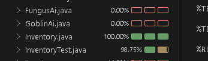

It only took one attempt to be able to create functional test. some of these test have test within themselves however it still test the same functionality. its to prevent excessive tests. Therefore only 9 seperate test were needed to achieve 100% coverage. 

these functions are very explicit from testing addition, removal, full, extra items, if an item is in the inventory, along with the exception test within the test instead of creating another test.