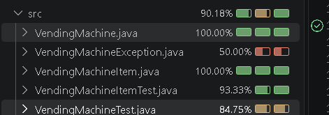

		//INJECTED FAULT FOR COVERAGE EXPERIMENT REMOVED THE =
		if ((item != null) && (this.balance > item.getPrice()))

        My test failed because I did not make a test that mimicked if balance = price, in any case if it does = price it should allow the user to buy an item but if I had a test that tested if balance = price it would fail 

        my test coverage was always at 100% for everything

        